# JabeX (جعبه ایکس)

**Private, offline-first digital Leitner Box.**

Flashcards only. No notes. No cloud account. Persian-first.

## Goals

- Create your first deck in **≤ 30 seconds**
- Complete your first review in **≤ 2 minutes**
- Keep all study data on your device

## Stack

| Layer | Technology |
|-------|------------|
| Frontend | Next.js (App Router) + TypeScript + Tailwind CSS v4 |
| UI system | [shadcn/ui](https://ui.shadcn.com/docs/components) |
| Desktop | Tauri 2 + Rust |
| i18n | `fa` (default, RTL) · `en` (LTR) |
| Themes | Light · Dark · System |
| Card faces | TipTap JSON (`document_v2`) — spoilers, math, tables, Markdown modes |

## Monorepo

```
apps/desktop/frontend   # Next.js UI
apps/desktop/src-tauri  # Tauri / Rust host
packages/types          # Shared TypeScript contracts
docs/                   # Product & architecture docs (one topic per folder)
.cursor/rules/          # Cursor AI agent rules
```

## Quick start

```bash
pnpm install
cp .env.example .env
pnpm dev
```

Open [http://localhost:3000](http://localhost:3000).

### Desktop (requires Rust)

```bash
# Install Rust: https://rustup.rs/
pnpm tauri:dev
```

### Download (Windows)

**Requirements:** Windows 10 or 11, 64-bit (x64) · [Microsoft Edge WebView2 Runtime](https://developer.microsoft.com/microsoft-edge/webview2/) (usually preinstalled).

| Distribution | File |
|--------------|------|
| NSIS installer (recommended) | `JabeX_0.1.0_x64-setup.exe` |
| MSI installer | `JabeX_0.1.0_x64_en-US.msi` |
| Portable ZIP (no admin) | `JabeX-0.1.0-portable.zip` |

Checksums: `SHA256SUMS.txt` next to the artifacts. Installers are **unsigned** for now — SmartScreen may warn; choose “More info” → “Run anyway” when you trust the build.

JabeX is local-first: no accounts, no telemetry, no cloud sync, no auto-updater.

### Build Windows installers (production)

```bash
pnpm typecheck
pnpm tauri:build
pnpm release:assemble
```

Artifacts:

```
release/
├── JabeX_0.1.0_x64-setup.exe
├── JabeX_0.1.0_x64_en-US.msi
├── JabeX-0.1.0-portable.zip
└── SHA256SUMS.txt
```

Portable folder only (no zip / installers):

```bash
pnpm portable:build
```

```
dist/JabeX-0.1.0-portable/JabeX.exe
```

See [Packaging](./docs/PACKAGING/PACKAGING.md) and [Release checklist](./docs/RELEASE_CHECKLIST.md). Tag `v*` to publish installers via GitHub Actions.

## Quality checks

```bash
pnpm lint
pnpm typecheck
pnpm test
```

## Screenshots

Captured from a real desktop session with **isolated demo data** only (never your personal profile).  
Default product shots: **Persian (`fa`) · RTL · light theme**. Variants are noted under each image.

### App overview

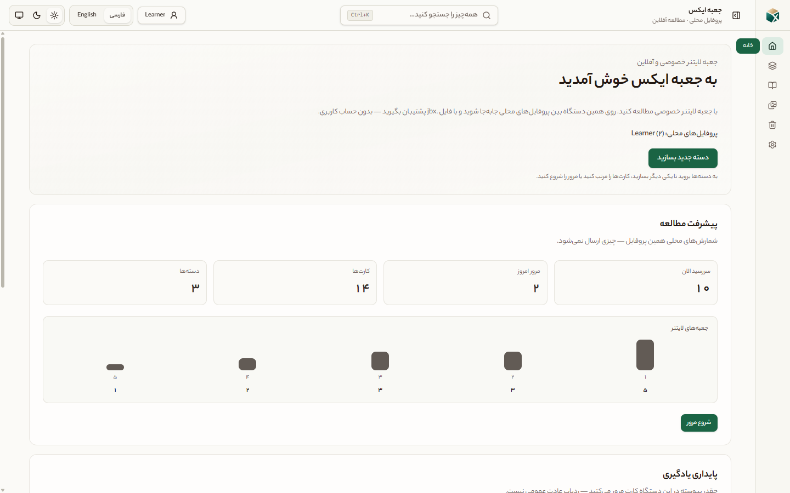

*Hero — shell, sidebar, header search, theme & language switchers (`fa` RTL, light).*

### Study workflow

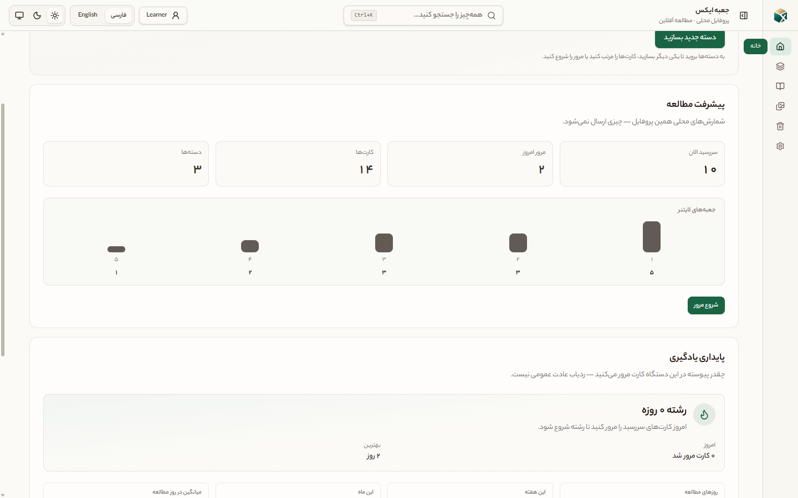

*Home dashboard — due cards, Leitner bars, study streak (`fa` RTL, light).*

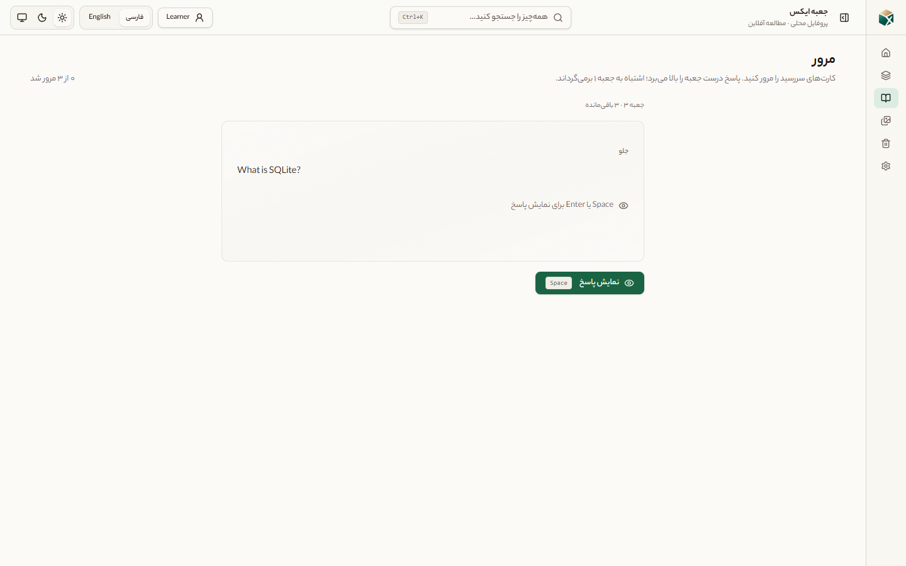

*Review — card front / question state with progress (`fa` RTL, light).*

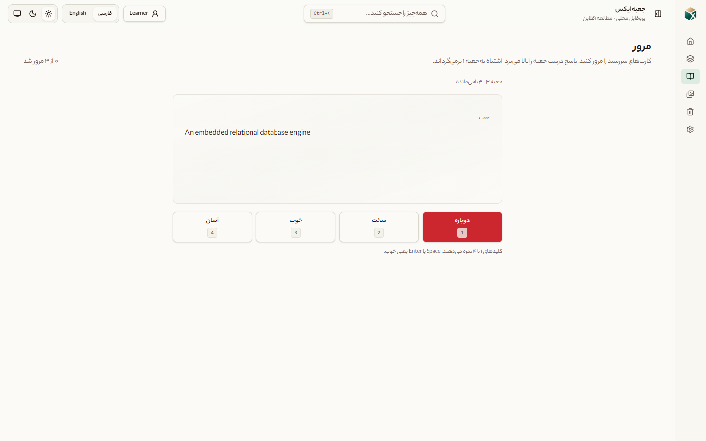

*Review — answer revealed with Again / Hard / Good / Easy (`fa` RTL, light).*

### Deck management

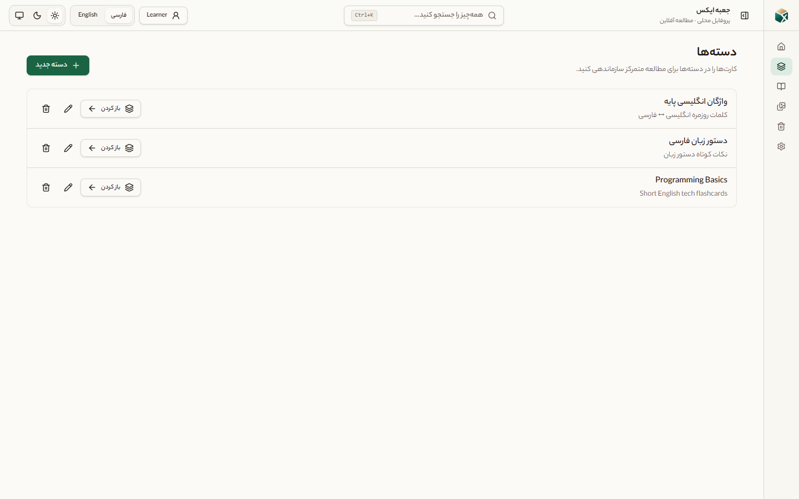

*Deck list with open / rename / delete actions (`fa` RTL, light).*

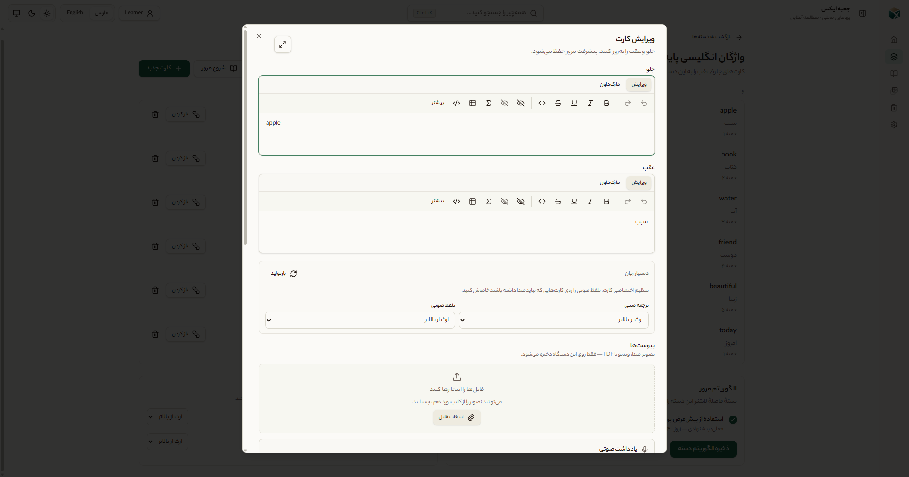

*Card editor — TipTap front/back, language assist, attachments (`fa` RTL, light).*

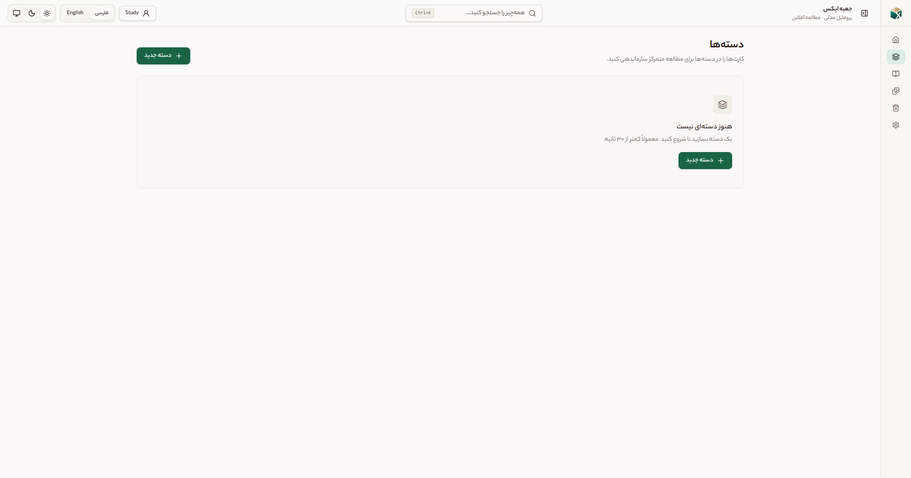

*Empty decks — first-deck CTA under a clean local profile (`fa` RTL, light).*

### Search, profiles & backup

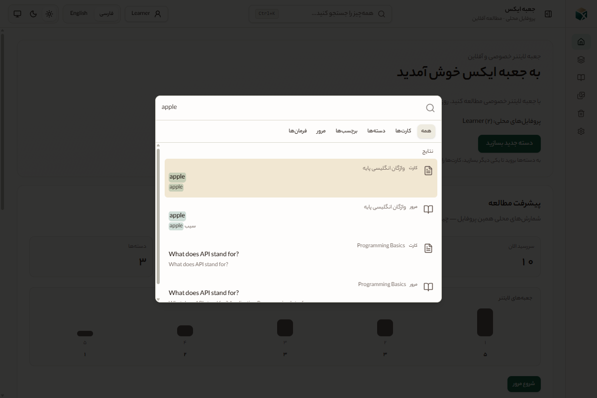

*Command palette search (`Ctrl+K`) with filters and results (`fa` RTL, light).*

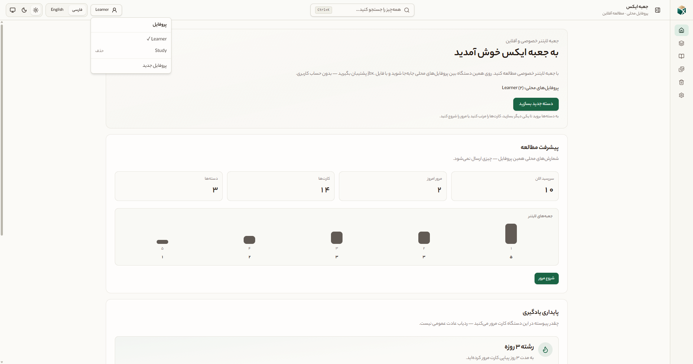

*Local profile switcher — no accounts (`fa` RTL, light).*

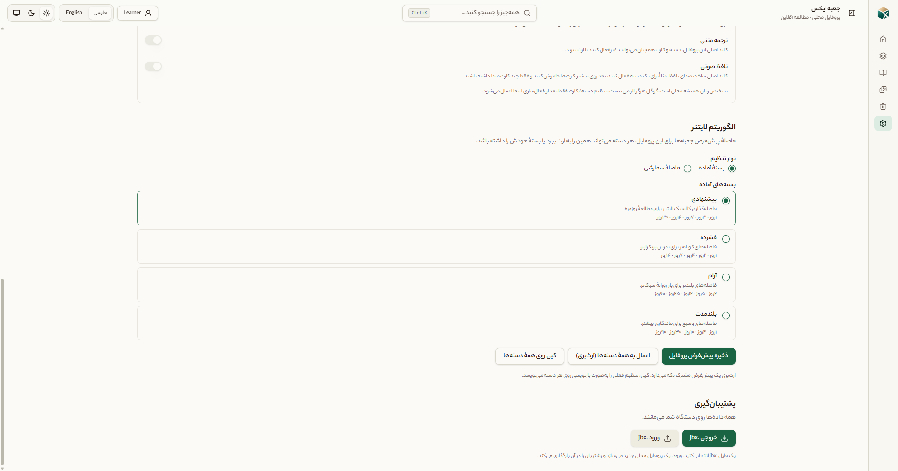

*Settings → export portable `.jbx` backup (`fa` RTL, light).*


*Settings → import / restore from `.jbx` (`fa` RTL, light).*

### Settings, theme & language


*Application preferences and keyboard shortcuts (`fa` RTL, light).*

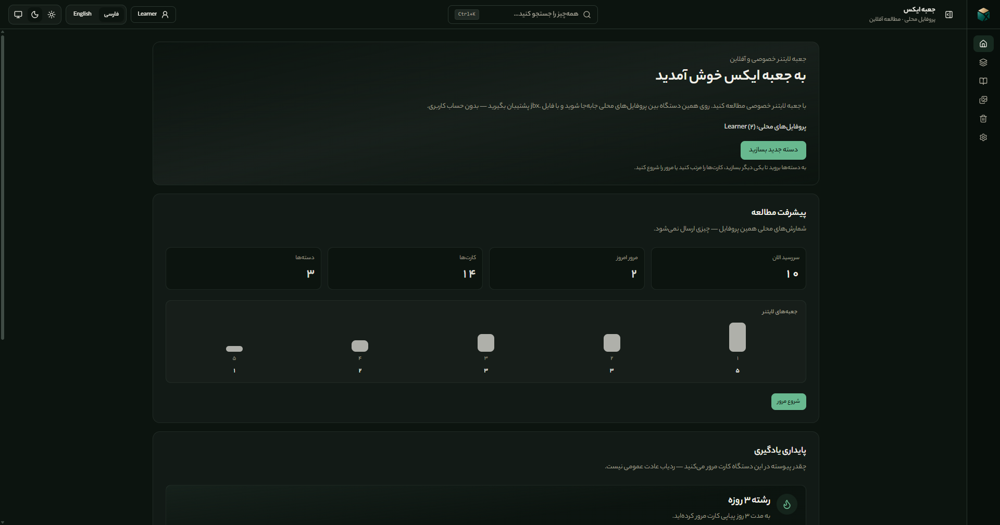

*Dark theme — same home shell (`fa` RTL, **dark**).*

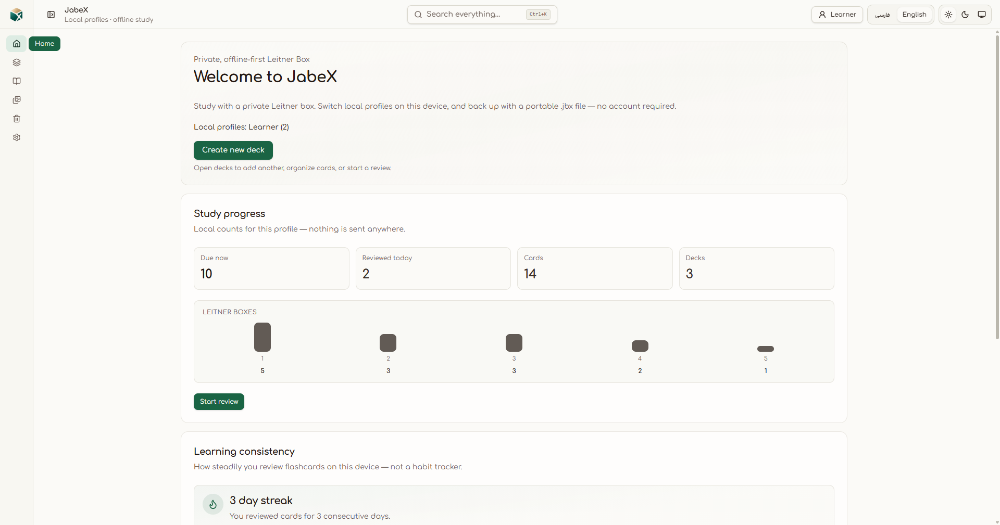

*English UI — LTR layout and typography (`en` **LTR**, light).*

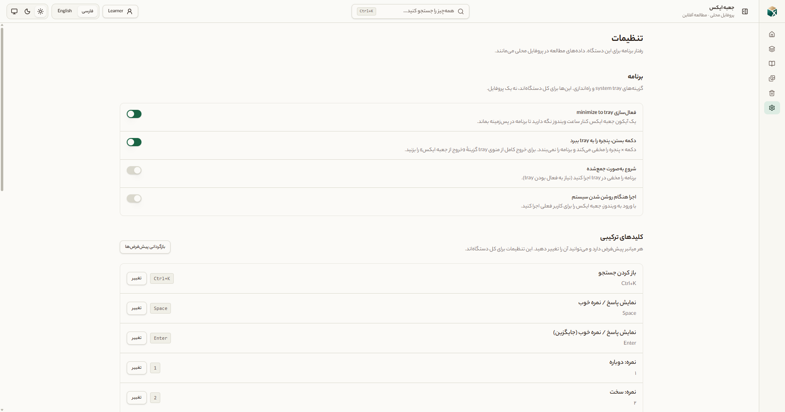

*Minimize-to-tray and startup options (`fa` RTL, light).*

Regenerate (isolated `.tmp/docs-capture-data` only):

```bash
pnpm docs:screenshots
```

Requires a working `pnpm tauri:dev` toolchain. Details: [Development → Screenshots](./docs/DEVELOPMENT/DEVELOPMENT.md#documentation-screenshots).

## Documentation

- **[Docs index](./docs/README.md)** — start here
- [Product](./docs/PRODUCT/PRODUCT.md)
- [Architecture](./docs/ARCHITECTURE/ARCHITECTURE.md)
- [Database](./docs/DATABASE/DATABASE.md)
- [Development](./docs/DEVELOPMENT/DEVELOPMENT.md)
- [Packaging](./docs/PACKAGING/PACKAGING.md)
- [Release checklist](./docs/RELEASE_CHECKLIST.md)
- [Testing](./docs/TESTING/TESTING.md)
- [Git workflow](./docs/GIT_WORKFLOW/GIT_WORKFLOW.md)
- [Roadmap](./docs/ROADMAP/ROADMAP.md)
- [ADR 014 — Advanced card editor](./docs/ADR/014-advanced-card-editor/014-advanced-card-editor.md)
- [Contributing](./CONTRIBUTING.md)
- [Code of Conduct](./CODE_OF_CONDUCT.md)
- [Security](./SECURITY.md)
- [Changelog](./CHANGELOG.md)

## License

[MIT](./LICENSE)
